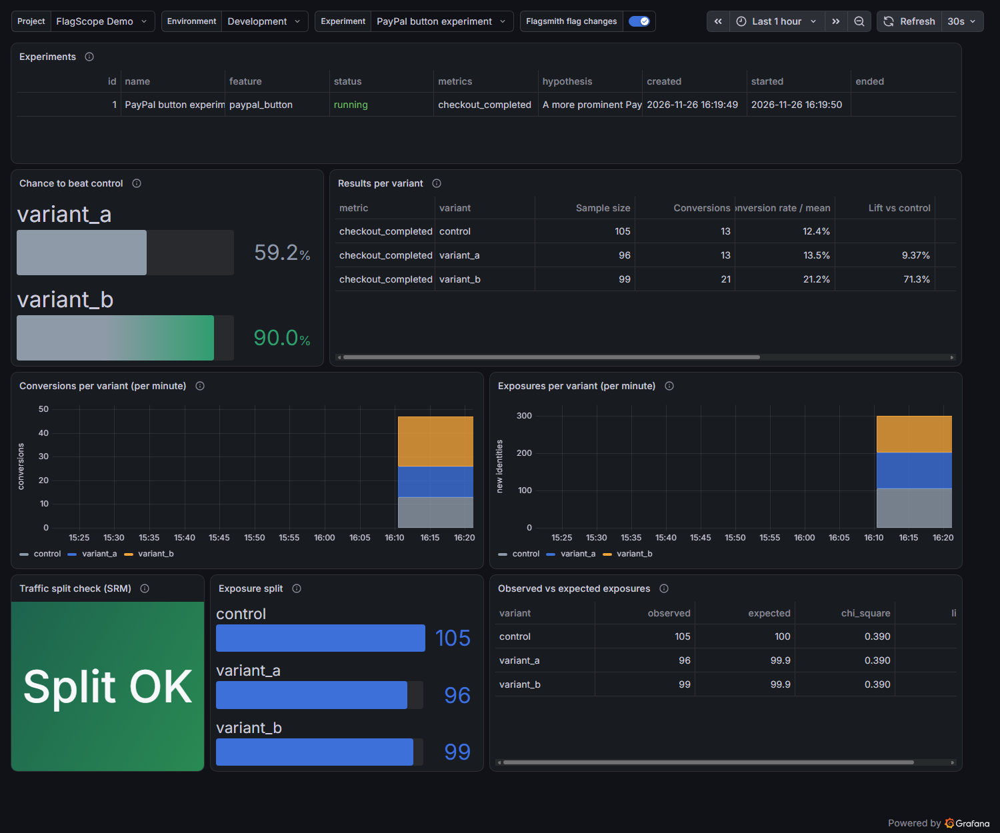

# FlagScope: Flagsmith Experimentation inside the Grafana you already run

Your self-hosted Flagsmith experiments, live in Grafana: win probability, lift and traffic health on one dashboard,
with Flagsmith flag changes drawn on the charts. Read only. Built for the Flagsmith "Toggle Wars" hackathon, Track 3
(self-hosted Flagsmith, integrations and plugins).




<!-- GIF placeholder: docs/img/demo.gif (10 s: simulator running, panels filling, SRM turning red) -->

## The problem

Flagsmith Experimentation computes good results (chance to beat control, lift, credible intervals), but they only live
in the Flagsmith UI. Teams that self-host Flagsmith already watch everything else in Grafana, and an experiment with a
broken traffic split (sample ratio mismatch) is worthless while nobody is looking at it.

FlagScope puts the numbers next to your other dashboards and tells you when the split is wrong.

## What you get

| Piece | Where | What it does |
|---|---|---|
| FlagScope data source plugin | `plugin/` | Query types `experiments` and `results`, template variables (project, environment, experiment), "Save & test" that checks `experimentation_enabled`. TypeScript, no backend. |
| Experiment Room dashboard | `stack/grafana/dashboards/experiment-room.json` (uid `flagscope-experiment-room`) | Experiments table, chance to beat control per variant, results table, conversions and exposures per minute per variant, exposure split, SRM (chi-square) check that turns red, Flagsmith flag-change annotations. |
| Gatekeeper | `stack/gatekeeper/gatekeeper.mjs` | A small zero-dependency allow-list proxy (one file, `node:http` only). It holds the Flagsmith master key so Grafana does not. |
| One-command stack | `stack/docker-compose.yml` | Flagsmith 2.295.2 (pinned) + Postgres + Grafana 13.2.7 + gatekeeper + a one-shot bootstrap that creates everything. |
| Simulator | `simulator/simulate.mjs` | Real `@flagsmith/nodejs` SDK traffic, deterministic, with `--skew` to break the split on purpose. |

## Quickstart (about 5 minutes after the images are pulled)

Prerequisites: Docker (Compose v2), Node 22 and pnpm (to build the plugin once).

```bash
git clone <this repo> && cd flagscope
cd plugin && pnpm install && pnpm build && cd ../stack      # the stack mounts plugin/dist
cp .env.example .env                                         # set GRAFANA_ADMIN_PASSWORD
docker compose up -d --wait                                  # Flagsmith, Postgres, Grafana, gatekeeper, bootstrap
```

`--wait` returns when the bootstrap has finished. It creates the Flagsmith organisation, project, environments, the
database warehouse, the multivariate flag `paypal_button`, the metric `checkout_completed` and a running experiment, then
wires Grafana (data sources, Flagsmith's own Grafana integration, Feature Health contact point). It is idempotent: run
it again and it reports `0 change(s) (no-op)`.

Open the dashboard at http://localhost:3000 (it is the Grafana home page, anonymous viewing is on in this demo stack).
Flagsmith is at http://localhost:8000; the generated logins are in `stack/.generated/credentials.txt` (gitignored).
Grafana admin is `admin` with the password from `stack/.env`.

Send traffic (from the repository root, so `cd ..` out of `stack/` first):

```bash
pnpm --dir simulator install
pnpm --dir simulator simulate --users 300              # natural split, about a third per variant
pnpm --dir simulator simulate --users 300 --skew 70 --seed 2   # 70% of exposures to control: SRM turns red
```

The simulator reads the environment key and master key from `stack/.generated/state.json`, so it needs no arguments
against the local stack. All users are labelled `sim-...`; this is simulated traffic. It asks Flagsmith to refresh the
results at the end (Flagsmith allows one refresh per 5 minutes).

Stop with `docker compose stop` (keeps data) or `docker compose down -v` (wipes everything).

On Windows with Docker Desktop, Docker is usually not on PATH:
`$env:Path += ";C:\Users\<you>\AppData\Local\Programs\DockerDesktop\resources\bin"`.

## Use it with your own Grafana

The plugin is unsigned until it is published, so allow it explicitly.

1. Build it: `cd plugin && pnpm install && pnpm build`, then copy `plugin/dist` to
   `<grafana plugins dir>/abhi0404-flagscope-datasource`. A release zip is planned.
2. Set `GF_PLUGINS_ALLOW_LOADING_UNSIGNED_PLUGINS=abhi0404-flagscope-datasource` and restart Grafana (Grafana 13.2 or
   newer).
3. Run the gatekeeper next to Flagsmith (see below), then add a data source of type "FlagScope for Flagsmith" with
   uid `flagscope`: Flagsmith URL = the gatekeeper URL, API key left empty.
4. For the live per-minute panels, add a PostgreSQL data source with uid `flagscope-postgres` on the Flagsmith database
   using a read-only role (`stack/postgres-init/01-readonly.sql`), then import
   `stack/grafana/dashboards/experiment-room.json`.

### The gatekeeper note (please read before giving anyone Viewer access)

Grafana's data source proxy matches routes by path prefix only. If you paste a Flagsmith master key straight into the
data source, every Grafana user who can query it (including anonymous Viewers, if you enable them) can read anything
under `/api/v1/projects/` and `/api/v1/environments/` with that key: identities (PII), server-side environment keys,
webhook URLs and more. The key never reaches the browser, but the access does.

The gatekeeper closes that. It holds the master key and forwards only these exact method and path pairs (the ones the plugin uses, plus the aggregate `exposures/` counts kept
for a planned query type):

| Method | Path (trailing slash required) |
|---|---|
| GET | `/version/` (sent without any key) |
| GET | `/api/v1/projects/`, `/api/v1/environments/?project=<id>` |
| GET | `/api/v1/environments/<key>/experiments/`, `.../experiments/<id>/`, `.../results/`, `.../exposures/` |
| POST | `/api/v1/environments/<key>/experiments/<id>/results/refresh/` (the only write) |

Everything else answers 403 and never reaches Flagsmith (project features and feature states are refused too: they
carry remote config values and feature owners). Client `Authorization`, `Host` and `X-Forwarded-*` headers are
dropped; paths with `..`, any percent-encoding, backslashes, `;` or `//`, and unknown or repeated query parameters are
refused; request bodies are never forwarded (a client that streams more than 16 KiB is disconnected); logs contain
method, path and status only.

```bash
# From the repository root. The key goes in a file so it does not show up in `docker inspect` or shell history.
mkdir -p gatekeeper-secrets && chmod 700 gatekeeper-secrets
( umask 077; printf '%s\n' '<organisation master API key>' > gatekeeper-secrets/master-key )
docker run -d --name flagscope-gatekeeper --network <network shared with Grafana and Flagsmith> \
  --read-only --cap-drop ALL --security-opt no-new-privileges \
  -e UPSTREAM_URL=http://flagsmith:8000 -e MASTER_KEY_FILE=/secrets/master-key \
  -v "$PWD/gatekeeper-secrets:/secrets:ro" \
  -v "$PWD/stack/gatekeeper/gatekeeper.mjs:/app/gatekeeper.mjs:ro" \
  node:22-alpine node /app/gatekeeper.mjs
```

`-e MASTER_KEY=<key>` also works, but then the key is visible in the container configuration.

Do not publish its port. In the bundled stack the master key is written by the bootstrap to a file that only the
gatekeeper container can read (`MASTER_KEY_FILE`), and the Grafana data source stores no key at all.

Results refresh stays Grafana Admin only (the plugin route has `reqRole: Admin`). Viewers read the last computed results.

## How Flagsmith is used

| Flagsmith surface | How FlagScope uses it |
|---|---|
| Experimentation REST API (Beta) | Reads experiments, experiment detail and results through the gatekeeper. The single write is the throttled `results/refresh/` (at most once per 5 minutes per experiment). |
| Flagsmith database warehouse (Postgres) | SDK events (`$flag_exposure` and custom events) are read directly with a read-only role for the per-minute exposure and conversion charts and the SRM chi-square. Flagsmith's own `srm_p_value` is empty in 2.295.2, so the test is computed in SQL. |
| Flagsmith SDK events | The simulator uses the real Node SDK: `getExperimentFlag` records exposures, `trackEvent` records conversions. |
| Grafana integration (annotations) | Flagsmith pushes a Grafana annotation on every flag change; the dashboard shows them on the time series. Set up by the bootstrap. |
| Feature Health | A Grafana contact point that posts to a Flagsmith Feature Health webhook is created by the bootstrap, so a Grafana alert on the SRM check can mark the flag Unhealthy. The alert rule itself is not provisioned yet (see Limits). |

## What FlagScope is not

It never ends, completes or rolls out an experiment, never edits flags, and does not scan code. It watches.

## Limits

- The Experimentation API is Beta and the Flagsmith database warehouse is meant for evaluation, not production volume.
- The SRM check uses exact chi-square critical values (p < 0.01) for 2-7 arms and the Wilson-Hilferty approximation
  (within 0.3 percent) for more. Expected shares come from the experiment rollout allocation, so it needs a started
  experiment (before that the panel shows "Split OK" with no limit). It counts only exposures of this experiment
  (from its start, and by `experiment_id` in the event metadata), and any exposure to a variant that is not in the
  plan turns it red on its own. If no allocation is found at all (the rollout segment override was removed), there is
  no plan to test against: the check stays "Split OK" and the tables show no expected values.
- Provisioned alert rule (SRM to Feature Health) is not shipped yet; the contact point exists, the rule is next.
- The plugin id uses the placeholder org slug `abhi0404`; it changes before a signed release.
- Anonymous Viewer access in the demo stack also lets visitors run read-only SQL on the granted Flagsmith tables
  through the PostgreSQL data source (identifiers of simulated users, client environment keys). Fine for a local demo,
  not for production.

## Development

```bash
cd plugin
pnpm install
pnpm typecheck && pnpm lint && pnpm test:ci && pnpm build     # never `pnpm test` (watch mode)
node --test ../stack/gatekeeper/gatekeeper.test.mjs            # gatekeeper allow-list tests, no dependencies
```

More detail in `docs/HANDOFF.md`, `docs/phase0-facts.md` (every verified Flagsmith fact) and `docs/events-sql.md`.

## License

Apache License 2.0, see `LICENSE`.
